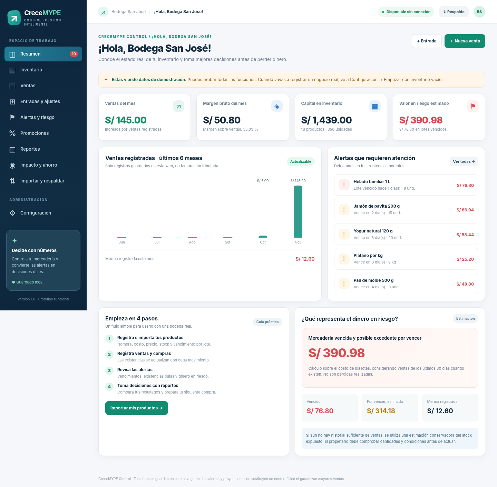

# CreceMYPE Control

Sistema web de gestión de inventario para bodegas y pequeños comercios en Perú. **Prototipo académico funcional (v1.1)**, diseñado para uso local desde un navegador.



## Probar el sistema

- Para verlo en línea con GitHub Pages, abre el enlace publicado en la sección **Settings → Pages** del repositorio.
- Para usarlo sin internet, descarga este repositorio en ZIP, descomprímelo y abre `index.html` en Chrome o Edge.
- Para probar el inventario con 1.000 artículos ficticios, importa `demo/CreceMYPE_1000_Productos_DEMO.csv` desde la sección **Importar y respaldar**.

## Funciones

- Inventario: alta y edición de productos, códigos, precios, costos, categorías y existencias.
- Lotes: diferentes fechas de vencimiento para un mismo producto, cuando corresponda.
- Caja y ventas: carrito, registro de ventas y descuento automático de existencias.
- Compras: ingreso de mercadería y control de proveedores.
- Alertas: vencimientos próximos, existencias bajas y mercancía en riesgo.
- Mermas y ajustes: pérdidas por deterioro o vencimiento, ajustes tras conteos.
- Promociones: simulación del precio y del margen de una promoción.
- Reportes: ventas, costos, márgenes y mermas registradas.
- Impacto: comparación de pérdidas de referencia con los registros y simulador de escenarios.
- Importación y respaldo: archivos CSV, exportación y restauración de una copia de seguridad.
- Diseño adaptable a pantalla grande y móvil.

## Organización de archivos

```text
index.html       # Página y vistas
styles.css       # Estilos y diseño adaptable
app.js           # Lógica de negocio y almacenamiento del navegador
capturas/        # Imágenes de referencia
demo/           # Catálogo ficticio de 1.000 artículos
```

## Publicar en GitHub Pages

1. Crea un repositorio público llamado `crecemype-control` en GitHub.
2. Sube el contenido de esta carpeta a la rama `main`, dejando `index.html` en la raíz.
3. En **Settings → Pages → Build and deployment**, elige **Deploy from a branch**, rama `main` y carpeta `/ (root)`.
4. Guarda. Al completarse la publicación, GitHub mostrará la URL de Pages.

También puedes conectar este repositorio a Netlify. Al ser una web estática, basta con publicar la raíz del repositorio.

## Datos y limitaciones

- La información **se guarda exclusivamente en el almacenamiento local del navegador** (localStorage); no existe una base de datos central ni sincronización entre dispositivos.
- No hay cuentas, inicio de sesión ni control de acceso. No se recomienda subir datos sensibles o utilizarlo como sistema de producción sin desarrollar backend, autenticación, copias de seguridad centralizadas y medidas de seguridad.
- Los ahorros, escenarios y precios de la sección **Impacto** son **simulaciones**; no son resultados de un piloto comercial verificado.
- El catálogo de 1.000 artículos incluido es totalmente ficticio.
- Para conservar información entre navegadores, exporta un respaldo e impórtalo en el navegador de destino. No permite operaciones simultáneas entre dispositivos.

## Tecnología

HTML, CSS y JavaScript sin dependencias externas. Proyecto preparado para desplegarse en GitHub Pages o Netlify. No requiere `npm install` ni compilación.
